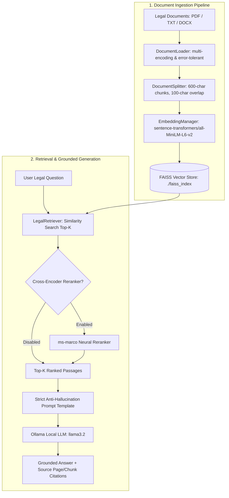

# ⚖️ Legal Case Files – RAG Knowledge Assistant

An enterprise-grade, privacy-first Retrieval-Augmented Generation (RAG) knowledge assistant for legal case documents, court filings, contracts, and dispute briefs. Built using **Python**, **LangChain**, **Hugging Face dense embeddings** (`sentence-transformers/all-MiniLM-L6-v2`), **FAISS vector indexing**, and **Ollama** running local, private Large Language Models (`llama3.2`).

[](https://www.python.org/)
[](https://www.langchain.com/)
[](https://github.com/facebookresearch/faiss)
[-blueviolet.svg)](https://ollama.ai/)
[](https://docs.pytest.org/)

---

## 📖 Table of Contents
- [Architecture Overview](#-architecture-overview)
- [Key Features](#-key-features)
- [Project Structure](#-project-structure)
- [Sample Legal Cases](#-sample-legal-cases)
- [Prerequisites & Installation](#-prerequisites--installation)
- [Ollama Setup & Model Download](#-ollama-setup--model-download)
- [Quickstart: Running Locally](#-quickstart-running-locally)
- [Streamlit Web Interface](#-streamlit-web-interface)
- [Automated Evaluation & Benchmarks](#-automated-evaluation--benchmarks)
- [Testing](#-testing)
- [Deployment Strategy](#-deployment-strategy)
- [Security & Privacy](#-security--privacy)
- [Troubleshooting](#-troubleshooting)

---

## 🏛️ Architecture Overview

The system processes multi-page legal documents, partitions them using clause-aware boundary splitters, indexes them into a high-performance FAISS vector store, and synthesizes grounded answers using local LLMs with strict anti-hallucination constraints.



---

## ⚡ Key Features

1. **Multi-Format Ingestion**: Native extraction for `.pdf` (page-indexed via `pypdf`), `.txt` (with multi-encoding fallback: UTF-8, Latin-1, CP1252), and `.docx`.
2. **Clause-Aware Chunking**: Recursive character text splitting configured with legal clause delimiters (`\n\n\n`, `\n\n`, `\n`, `. `, `; `, `, `) to prevent splitting operative provisions mid-sentence.
3. **Local Vector Search**: Embedded using 384-dimensional dense vectors from `sentence-transformers/all-MiniLM-L6-v2` and indexed with FAISS for sub-10ms retrieval on CPU.
4. **Strict Grounding & Anti-Hallucination**: Tailored legal system prompt instructing the model to answer **strictly and exclusively** from the provided context. If an answer is not present, the model explicitly declares non-availability.
5. **Exact Evidence Citations**: Every generated finding includes document filenames, exact page numbers, chunk identifiers, and similarity match scores.
6. **Graceful Edge-Case Handling**: Comprehensive handling for missing indexes, empty queries, unstarted Ollama servers, missing local models, corrupted PDFs, and unreadable files.
7. **Empirical Evaluation Suite**: Repeatable benchmark script measuring **Recall@k**, **Precision@k**, **Mean Reciprocal Rank (MRR)**, **Factual Keyword Coverage**, and **Negative Rejection Accuracy**.
8. **Modern Streamlit UI**: Glassmorphic dark slate interface with interactive document browser, telemetry metrics, and multi-tab workspace.

---

## 📁 Project Structure

```text
legal_case_files/
├── .env.example                  # Environment configuration template
├── .gitignore                    # Prevents leaking indexes, virtualenvs, or client docs
├── README.md                     # Comprehensive documentation and setup guide
├── EVALUATION.md                 # Empirical benchmark report with actual metrics
├── requirements.txt              # Pinned Python dependencies
├── app.py                        # Production-grade Streamlit web interface
├── evaluate.py                   # Repeatable CLI evaluation benchmark script
├── evaluation_results.json       # Exported raw evaluation metric data
├── data/
│   ├── sample_documents/         # Synthetic, non-confidential legal test case files
│   │   ├── 01_Criminal_Case_File_Chowdary.pdf / .txt / .docx
│   │   ├── 02_Commercial_Dispute_Case_File_BlueWave.pdf / .txt / .docx
│   │   ├── 03_Property_Dispute_Case_File_LakshmiDevi.pdf / .txt / .docx
│   │   └── 04_Employment_Tribunal_Case_File_AnilKumar.pdf / .txt / .docx
│   └── evaluation_dataset.json   # 14 ground-truth benchmark Q&A pairs (in-domain & negative)
├── rag_assistant/                # Core modular RAG package
│   ├── __init__.py               # Package exports
│   ├── config.py                 # RAGConfig dataclass with environment overrides
│   ├── loader.py                 # DocumentLoader supporting PDF, TXT, DOCX & error states
│   ├── splitter.py               # DocumentSplitter with legal boundary separators & metadata
│   ├── embeddings.py             # HuggingFace EmbeddingManager with caching & CPU/CUDA selection
│   ├── vectorstore.py            # FAISSVectorStoreManager with save/load & stats
│   ├── retriever.py              # LegalRetriever with similarity search & CrossEncoder reranker
│   ├── generator.py              # LegalResponseGenerator with Ollama and strict grounding
│   ├── pipeline.py               # LegalRAGPipeline end-to-end coordinator
│   └── evaluator.py              # RAGEvaluator calculating Recall, Precision, MRR, and Grounding
├── tests/                        # Pytest automated test suite (22 tests)
│   ├── test_loader.py            # Extraction, empty files, corrupted files, unsupported formats
│   ├── test_splitter.py          # Boundary enforcement, metadata propagation, stats
│   ├── test_vectorstore.py       # Index lifecycle, persistence, reload, vector search
│   ├── test_retriever.py         # Query retrieval, top-k ranking, scoring
│   ├── test_generator.py         # Grounding constraints, format context, mock provider
│   └── test_pipeline.py          # Full pipeline flow, missing index, empty query handling
├── notebooks/                    # Preserved exploratory notebooks
│   └── legal.ipynb
└── legacy/                       # Preserved prototype files
    ├── legal_app.py
    └── legal_cli.py
```

---

## 📜 Sample Legal Cases

All test documents in `data/sample_documents/` are **purely synthetic, illustrative legal case files** created for research and educational purposes:

| Case File | Dispute Type | Key Legal Subject Matter |
|---|---|---|
| `01_Criminal_Case_File_Chowdary` | Criminal Law | State of Telangana vs. Vikram Chowdary (IPC 420, 468, 471 – bank loan forgery & cheating) |
| `02_Commercial_Dispute_Case_File_BlueWave` | Commercial Arbitration | BlueWave Constructions vs. Orion Infra Solutions (₹2.85 Cr contract breach, delay damages, Clause 18 arbitration) |
| `03_Property_Dispute_Case_File_LakshmiDevi` | Civil Property | Lakshmi Devi vs. Ramesh Naidu (2.5 acres agricultural land title declaration, registered gift settlement deed) |
| `04_Employment_Tribunal_Case_File_AnilKumar` | Employment / Labor | Anil Kumar vs. Vertex Software Solutions (Wrongful termination, non-compete covenant, open-source code defense) |

---

## 🛠️ Prerequisites & Installation

### 1. System Requirements
- **OS**: Windows 10/11, macOS, or Linux
- **Python**: Version 3.10, 3.11, or 3.12
- **RAM**: Minimum 8 GB (16 GB recommended for local LLM inference)

### 2. Clone and Setup Environment
```bash
# Clone the repository
git clone https://github.com/bathulapoojitha2206-bit/Legal_case_files.git
cd legal_case_files

# Create a virtual environment
python -m venv venv

# Activate the virtual environment
# Windows (PowerShell):
.\venv\Scripts\Activate.ps1
# Linux / macOS:
source venv/bin/activate

# Install required dependencies
pip install -r requirements.txt
```

### 3. Environment Variables
Copy the example environment file:
```bash
copy .env.example .env    # Windows
cp .env.example .env      # Linux/macOS
```
The application runs entirely on local defaults (`OLLAMA_BASE_URL=http://localhost:11434`, `OLLAMA_MODEL=llama3.2`, `EMBEDDING_MODEL=sentence-transformers/all-MiniLM-L6-v2`). No external API keys are required for local operation.

---

## 🦙 Ollama Setup & Model Download

This project relies on **Ollama** to execute local, private Large Language Models on your hardware.

1. **Install Ollama**:
   - Download the installer from [ollama.ai/download](https://ollama.ai/download) for your OS.
2. **Start the Ollama daemon**:
   ```bash
   ollama serve
   ```
   *(On Windows and macOS, the Ollama desktop app runs this in the background automatically).*
3. **Pull the Llama 3.2 model** (Fast, lightweight 3B parameter model optimized for instruction following):
   ```bash
   ollama pull llama3.2
   ```
4. **Verify running models**:
   ```bash
   ollama list
   ```
   You should see `llama3.2:latest` listed in the output.

---

## 🚀 Quickstart: Running Locally

### Step 1: Ingest and Index Documents
Run the pipeline to index the synthetic case files into FAISS:
```python
from rag_assistant.pipeline import LegalRAGPipeline

pipeline = LegalRAGPipeline()
report = pipeline.ingest_directory("data/sample_documents")
print(f"Indexed {report.total_chunks} chunks in {report.duration_seconds}s!")
```

### Step 2: Query the Assistant via Python
```python
result = pipeline.ask("What penal code sections is Vikram Chowdary charged under?")

print("\n--- ANSWER ---")
print(result.answer)

print("\n--- SOURCES ---")
for s in result.sources:
    print(f"File: {s['filename']} | Page: {s['page']} | Match Score: {s['score']}")
```

---

## 🖥️ Streamlit Web Interface

Launch the interactive web assistant:
```bash
streamlit run app.py
```

The application will open in your default browser at `http://localhost:8501`.

### Interface Highlights:
- **Case Intelligence Tab**: Ask legal questions, view structured findings, and explore source citations with page numbers and match confidence.
- **Document Browser Tab**: Inspect indexed documents, read full transcripts, and preview raw page extractions.
- **Benchmark Evaluation Tab**: Review empirical retrieval metrics (Recall@k, Precision@k, MRR, Rejection Accuracy).
- **Diagnostics & Ingestion**: One-click upload for new PDFs/TXTs, real-time Ollama health checks, and parameter tuning (Top-K, Chunk Size, Reranker).

---

## 📊 Automated Evaluation & Benchmarks

To run the repeatable evaluation suite across all 14 ground-truth legal test cases:
```bash
python evaluate.py --k 4 --model llama3.2
```

### Evaluation Parameters:
- `--dataset`: Path to benchmark JSON (default: `data/evaluation_dataset.json`).
- `--docs`: Directory containing documents to ingest if index is missing.
- `--k`: Number of candidate passages retrieved (default: 4).
- `--model`: Ollama model name (default: `llama3.2`).
- `--rerank`: Optional flag to enable neural Cross-Encoder reranking.
- `--output-json`: File to save raw metrics (default: `evaluation_results.json`).
- `--output-md`: File to save formatted report (default: `EVALUATION.md`).

For detailed methodology, individual test outputs, and full empirical findings, see [EVALUATION.md](EVALUATION.md).

---

## 🧪 Testing

The repository includes a comprehensive `pytest` suite covering document loading, text chunking, FAISS index serialization, retrieval ranking, grounding constraints, and edge-case failure handling.

To execute the test suite:
```bash
python -m pytest tests/ -v
```

### Test Coverage Summary:
- `tests/test_loader.py`: PDF extraction, UTF-8/Latin-1 fallback, 0-byte file detection, unreadable/corrupted files, unsupported extension rejection.
- `tests/test_splitter.py`: Chunk boundary checks, overlap enforcement, metadata enrichment (`chunk_id`, `chunk_preview`).
- `tests/test_vectorstore.py`: Index creation, vector dimension verification, disk serialization (`.faiss` & `.pkl`), clean reload, missing index exception handling.
- `tests/test_retriever.py`: Similarity search top-k accuracy, score ranking, empty query handling.
- `tests/test_generator.py`: Grounding refusal on zero passages, context formatting with citations, mock provider generation.
- `tests/test_pipeline.py`: Full end-to-end RAG workflow, missing index warning, empty input handling.

---

## 🌐 Deployment Strategy

### 1. Local Deployment (Default & Recommended)
Because this application runs a local LLM via Ollama (`llama3.2`), standard shared/serverless cloud hosts (e.g., free tiers of Streamlit Community Cloud, Heroku, or basic Render instances) **do not provide local Ollama servers or dedicated GPU acceleration**.

For full data privacy and zero API token costs:
- Run locally on workstations, firm intranets, or on-premises servers.
- Use `ollama serve` and access via the local Streamlit dashboard.

### 2. Cloud Hosting Options
If cloud deployment is required:
1. **GPU Virtual Machine (AWS EC2 / Azure VM / GCP Compute Engine)**:
   - Deploy on an instance with at least 8 GB RAM (e.g., AWS `t3.large` or `g4dn.xlarge` for GPU acceleration).
   - Install Ollama as a systemd service and run `streamlit run app.py --server.port 8501`.
2. **Streamlit Community Cloud / Cloud Platform with External LLM Provider**:
   - Set `LLM_PROVIDER=groq` or `LLM_PROVIDER=openai` in `.env` (or Streamlit Cloud Secrets).
   - Provide `GROQ_API_KEY` (low-cost / free-tier Llama 3.2 inference) or `OPENAI_API_KEY`.
   - The pipeline will automatically switch LLM generation to the configured cloud provider while maintaining Hugging Face CPU embeddings and FAISS locally.

> **Cost & API Key Security**: Never commit `.env` or raw API keys to source control. Use environment variables or platform secret managers.

---

## 🔒 Security & Privacy

- **Data Privacy**: No legal case files or client questions are transmitted to third-party APIs by default; all vector embeddings and LLM inference run strictly on your local machine.
- **Git Protection**: `.gitignore` is configured to prevent committing virtual environments (`venv/`), API keys (`.env`), client confidential folders (`data/private/`), and generated binary vector stores (`faiss_index/`).
- **Synthetic Data**: All bundled test case files represent fictitious legal matters and contain no privileged attorney-client communications.

---

## ❓ Troubleshooting

| Issue | Cause | Solution |
|---|---|---|
| `Cannot connect to Ollama at http://localhost:11434` | Ollama service is not running | Run `ollama serve` in your terminal or start the Ollama desktop app. |
| `Model 'llama3.2' is not downloaded in Ollama` | Model weights have not been pulled | Run `ollama pull llama3.2` in your terminal. |
| `No legal documents have been indexed yet` | FAISS index has not been built | Click **Load 4 Samples** in the Streamlit sidebar, or run `python evaluate.py`. |
| `Unsupported document format for file` | Uploaded file is not PDF, TXT, or DOCX | Convert document to `.pdf` or `.txt` before uploading. |
| `CUDA requested but not available` | PyTorch did not detect an NVIDIA GPU | System automatically falls back to CPU for embeddings and vector search without errors. |

---

## 📄 License
This project is licensed under the MIT License.
